import {OnlyOn, PlatformToggle} from '@site/src/components/Platform';

<PlatformToggle />

An Isoplane application is ordinary .NET code, but it runs inside a sandbox
rather than as a process on a server, and that changes some of what .NET lets
you do. Most of the differences on this page come from two design decisions:

1. Each instance of an application runs in a sandbox of its own, and
   everything it does beyond its own memory goes through Isoplane.
2. An instance gets a worker thread only while its code is running.

The first is what keeps applications apart on shared hardware: using the
network, reading files and reading the clock all go through Isoplane, so it
decides what an application can reach. The second is what lets many
applications share a few worker threads: an instance with no ready, eligible
request or background work sits idle without occupying one.

Each section below explains why something differs, what that gives you, and
what to change in your application, if anything. Where another page covers a
difference in more depth, the section links to it.

The limits Isoplane places on memory and running time are a separate subject:
see [execution limits](execution-limits.md).

## Units of work {#units-of-work}

Isoplane divides the work it gives an instance into two units: dispatches and
slices.

A *dispatch* is the unit of work Isoplane delivers to an instance. Request dispatches handle HTTP requests; background dispatches run instance
callbacks and retained operations, including timers. An instance can have several dispatches in
progress at once.

A *slice* is a period of time in which code from one dispatch is running on a
worker thread. An instance has at most one slice running at any moment, so
dispatches in progress on the same instance interleave, one slice at a time.
Slices do not preempt one another: a slice returns when its work awaits
something not ready, its bounded callback batch ends, or its dispatch finishes. The [clock](#time),
and whether the dispatch has been cancelled, stay fixed for the length of a
slice.

The timeline below shows one instance, with a row for each dispatch. Each bar
is a slice, and the gaps between a row's bars are waits, for a database query
for example.

```mermaid
---
displayMode: compact
---
gantt
    title One instance
    dateFormat x
    axisFormat %Q ms
    tickInterval 50millisecond
    todayMarker off
    section Request 1
    slice : 0, 40
    slice : 120, 160
    slice : 260, 290
    section Request 2
    slice : 45, 85
    slice : 170, 210
    slice : 295, 325
    section Request 3
    slice : 210, 250
    slice : 330, 360
```



Apart from initialization, an application's code runs only during dispatches.
Initialization is not a dispatch: it runs during template preparation, before any
instance exists. `Activation.Activated` callbacks run as part of an instance's
first dispatch. The rest of the time an instance sits idle, without occupying a
guest worker thread. Host I/O polls still consume accounted worker time, and
Isoplane can set the instance aside or discard it whenever it needs the room.

### How running time is counted {#resource-usage}

Each HTTP request has a
[running-time allowance](execution-limits.md#running-time). Instance background
work uses a separate [allowance](execution-limits.md#after-the-response), which
is replenished by elapsed host time and unused request time. A wake does not
create a new request allowance or a fresh background budget.

Both allowances charge occupied execution and reactor workers. Time parked on
I/O, waiting in a queue or waiting for background credit is excluded.

Forward the request's cancellation token to the calls you await. That token is
`HttpContext.RequestAborted`, or
[`RequestHead.Aborted`](../reference/sdk/Isoplane.Sdk/Isoplane/RequestHead/Aborted.md)
without ASP.NET. It is cancelled when the client goes away before it has the
whole response, or the dispatch uses up its running time, so passing it on
stops work that nobody is waiting for, and saves the running time that work
would use.

## A single-threaded instance {#single-threaded}

Each instance runs your application on exactly one thread;
`Environment.ProcessorCount` is 1. An instance can have several dispatches in
progress, which take turns on that thread one [slice](#units-of-work) at a
time, and Isoplane runs more instances to serve more requests than one
instance takes, up to the application’s instance limit. Because an instance needs a
thread only while its code is
running, one thread is enough, and a waiting instance does not occupy one at
all. Code in an instance never runs on two threads at once.

The dispatches in progress on an instance share its memory, so static fields
and singletons are shared between the requests they handle, as they are
between concurrent requests on any server. Code written for concurrent
requests needs no change.

### Starting a thread {#starting-a-thread}

Starting a thread throws `PlatformNotSupportedException`, and the build warns
about it as [`ISOPLANE1002`](../reference/error-codes.md#isoplane1002). Rewrite
such work as asynchronous code that the request awaits.

### The thread pool, `Task.Run` and `Parallel` {#thread-pool}

`Task.Run` and `ThreadPool.QueueUserWorkItem` don't get a thread of their own.
The thread pool runs on the instance's one thread, and the work they queue
runs when the current code next awaits or returns. `Task.Run` therefore
doesn't make work parallel, and doesn't stop it from delaying the response.

`Parallel.For` and `Parallel.ForEach` run their iterations one after another.

Code that uses any of these still works, without the speed-up it was written
for, so there is no need to remove them from code that also runs elsewhere.

### Concurrent I/O, sequential computation {#concurrency}

Asynchronous I/O is still concurrent, and it is the way to make a request
faster on Isoplane. Start several operations and `await Task.WhenAll(...)`,
and all of them are in flight while the instance waits.

Computation, by contrast, occupies the thread. While a method computes without
awaiting, nothing else in the instance runs: neither other asynchronous work of
the same dispatch nor the other dispatches in progress on the instance, which
wait for it. A cancellation token does not change until the method next awaits. A long computation also uses up the dispatch's running
time. To let cancellation reach one, split it up as
[Running time](execution-limits.md#running-time) describes.

### Thread-safe types

`Lazy<T>` in its default thread-safe mode, `ConcurrentDictionary`,
`ConcurrentQueue`, `ConcurrentStack` and `ConcurrentBag` work as usual, and
need no change.

## How locks work {#locks}

Locks behave as they do elsewhere; the difference is that only one thread ever
takes them. A free lock is taken at once, by `lock`, `Monitor.Enter` and
`Monitor.TryEnter`, `System.Threading.Lock`, `SpinLock`, `Mutex`,
`ReaderWriterLockSlim` and `ReaderWriterLock`, for reading or writing and with
or without a timeout. If a lock is already held, this same thread holds it, so
taking it again re-enters it: a lock
that allows recursion lets the code in, and one that does not throws
`LockRecursionException`, just as a thread re-entering its own lock would
anywhere else. A `SpinLock` that does not track its owner would wait for
itself forever elsewhere; here it throws `PlatformNotSupportedException`.

A lock therefore never makes other work in the same instance wait, and code
that takes locks needs no change to run here. To keep other asynchronous work
out of a section that awaits, use `SemaphoreSlim` with `await WaitAsync()`, as
you would on any platform, since no lock can be held across an `await`. Give
that wait a timeout or the request's cancellation token, so that a request
waiting behind another can still
[finish after cancellation](execution-limits.md#after-cancellation).

## Waits, delays and timers {#waits}

Waiting is asynchronous. A waiting instance sits idle without occupying a
worker thread, which is how many applications share a few worker threads, and
its waiting does not count toward the dispatch's
[running time](execution-limits.md#running-time). A wait that blocked would
occupy a worker thread that other applications need.

A wait that can be satisfied at once succeeds, as it does anywhere else:
taking a free `SemaphoreSlim` or `Semaphore`, waiting on a set event or a
finished task, and taking from a non-empty `BlockingCollection` all return
straight away, and a wait with a timeout of zero that cannot be satisfied
returns `false`.

A synchronous wait that would have to block throws
`PlatformNotSupportedException` straight away, whatever timeout it was given.
Nothing else in the instance can run while it waits, so nothing could release
the semaphore, set the event or finish the task, and the wait could only hold
the worker until it timed out; failing at once points you at the line to
change. `Monitor.Wait`, `Thread.Sleep` and joining the current thread always
have to wait, because only another thread could pulse the monitor or finish
the thread, so they throw whenever their timeout is not zero. Use the
asynchronous form of each call:

| Call | Throws | Use instead |
| --- | --- | --- |
| `task.Wait()`, `task.Result` | when the task has not finished | `await task` |
| `Task.WaitAll(...)` | when a task has not finished | `await Task.WhenAll(...)` |
| `Task.WaitAny(...)` | when no task has finished | `await Task.WhenAny(...)` |
| `semaphore.Wait()` on a `SemaphoreSlim` | when no slot is free | `await semaphore.WaitAsync()` |
| `Wait()` on a `ManualResetEventSlim` or a `CountdownEvent` | when the event is not set, or the count has not reached zero | `await` a `TaskCompletionSource` |
| `WaitOne()`, `WaitHandle.WaitAny(...)` and `WaitHandle.WaitAll(...)` on events or a `Semaphore` | when the handles are not signalled | `await` a `TaskCompletionSource`, or `await semaphore.WaitAsync()` on a `SemaphoreSlim` |
| `Take()` and `Add()` on a `BlockingCollection` | when it is empty, or full | `await` `ReadAsync` and `WriteAsync` on a `Channel` |
| `barrier.SignalAndWait()` | unless this is the last participant to arrive | — |
| `SpinWait.SpinUntil(...)` | when the condition is false | `await` the work the condition waits for |
| `Monitor.Wait(...)` | always, except with a timeout of zero | `await` a `TaskCompletionSource` |
| `Thread.Sleep(...)` | always, except `Thread.Sleep(0)` | `await Task.Delay(...)` |
| `Thread.CurrentThread.Join(...)` | always, except with a timeout of zero | — |

To wait for a while, `await Task.Delay(...)`. Delays and timers have the
[clock](#time)'s resolution of one millisecond, and a timer that comes due
while the application is computing runs once it next awaits. A timer can also
outlive the dispatch that started it; see
[What can run between requests?](#between-requests).

`task.Wait()` with no timeout, on a task that `Task.Run` queued and that has not
started yet, runs the task immediately on the current thread, as .NET can do
anywhere, and returns once it has finished.

`app.Run()` is caught when the application builds, before it can fail at run
time: use `await app.RunAsync()`.

Synchronous network calls follow the same rule. A synchronous socket call or
name lookup that would have to wait fails rather than waiting, so use the asynchronous methods.
A library's synchronous API usually blocks underneath: on an EF Core context,
call `SaveChangesAsync` and `ToListAsync`, not `SaveChanges` and `ToList`.

Some synchronous calls are easy to miss, because they do not look like I/O:

| Call | Why it waits | Use instead |
| --- | --- | --- |
| ASP.NET Core's `Request.Form`, before the form has been read | It reads the request body | `await Request.ReadFormAsync()` |
| `Read` on `Request.Body` and `Write` on `Response.Body` | They read and write the connection | `ReadAsync` and `WriteAsync` |
| Razor's `Html.Partial` and `Html.RenderPartial` | They wait for the partial view, which fails if the partial awaits anything | `<partial name="..." />`, or `await Html.PartialAsync(...)` |
| Entity Framework Core's `Add`, on an entity whose keys come from `UseHiLo` | It fetches a block of keys from the database, on the first call and whenever a block runs out, so it fails only occasionally | `await AddAsync(...)` |
| `using` on a data reader that still has unread rows | Disposing it reads the remaining rows | `await using` |

Some libraries block inside a call that looks asynchronous, or behind an
interface with no asynchronous form:
[Library compatibility](library-compatibility.md) lists the ones we know of.

The build warns about several of these calls as
[`ISOPLANE1003`](../reference/error-codes.md#isoplane1003), and the editor offers a quick fix
for most of them. It does not catch every case: `.Result` is not flagged, and
NuGet packages are not inspected unless you set
[`IsoplaneAnalyzeDependencies`](../reference/project-settings.md#isoplaneanalyzedependencies).
The `app.Run()` error is described in
[Adapt `Program.cs`](../how-to/onboard-an-application.md#adapt-programcs).

## The clock {#time}

The clock an application sees is deliberately coarse, and it doesn't advance
while code runs. This is a defence against Spectre and other side-channel attacks,
which work by timing tiny differences in how long the processor takes, and so
need a precise clock. Because applications share hardware, withholding a
precise clock from all of them protects each one from the others.

The clock is set at the start of each [slice](#units-of-work), and every reading
within a slice returns the same value, from `DateTime.UtcNow`, `Stopwatch` and
`Environment.TickCount64` alike. Its
resolution is one millisecond, although `Stopwatch.IsHighResolution` still
reports `true` and `Stopwatch.Frequency` still reports nanoseconds. Timers have
the same resolution.

Timers and cancellation tokens follow the same rule. A timer that comes due,
or a cancellation token that is cancelled, during a slice is seen only in the
next one. Checking a timer or `IsCancellationRequested` in a
loop that does not await never sees it change.

What follows from that:

- `Stopwatch` cannot time a piece of computation, and a benchmark run inside
  the application measures nothing. Run benchmarks on ordinary .NET outside
  Isoplane.
- Across an `await` that has to wait, `Stopwatch` measures from the start of
  the slice you started it in to the start of the slice you read it in. That
  includes the wait and the computation earlier in the first slice, so it is an
  upper bound on the wait, to the millisecond. An `await` on something already
  complete does not end the slice, so it does not advance the clock.
- Timestamps taken in the same slice are identical, so log lines the
  application stamps itself can all show the same time.
- A loop that computes and checks for its own deadline, whether by reading the
  clock, a timer or a cancellation token, never sees the deadline arrive. Split the work into parts
  and await something that waits between them, as
  [running time](execution-limits.md#running-time) describes.
- A timeout fires only between slices. `Task.Delay`,
  `CancellationTokenSource.CancelAfter` and `Timer` callbacks are delivered
  between calls into the guest, never in the middle of a computation.
  Request continuations run in their request's slices; instance callbacks run
  in background slices with their own allowance.

## Work after the response {#after-the-response}

An instance can retain connections, timers and asynchronous operations after a
request finishes. Isoplane can still hibernate or discard the instance.

### What has to finish before the response? {#before-the-response}

Everything the response depends on. At the empty-stack boundary after response
completion, remaining work becomes the instance's background work. The request
releases its concurrency slot and donates its unused running-time allowance to
the instance's [background allowance](execution-limits.md#after-the-response).
A request-body read still waiting fails because the request body is closed.

The handover includes host operations and their accounting. A pending Redis read
or telemetry export can complete later without keeping the original request
open or charging an unrelated request. A client disconnect after a complete
response does not cancel that work. Cancellation already requested while a
handler is still running retains its [grace deadline](execution-limits.md#after-cancellation).

An instance can be stopped before background work finishes. Save data required
by the response before responding; use an external durable queue for work that
must survive the instance.

### What can run between requests? {#between-requests}

Timers, retained operations and queued callbacks can run in background slices.
No opt-in is required. The host alternates ready request and background slices;
background work waits when its allowance is exhausted. A timer remains attached
to its instance, including when no request is running.

#### Running timers between requests {#run-timers-between-requests}

Background dispatches use the instance's background allowance, including
donated unused request time. This also applies
to timers maintained by libraries such as connection pools.

An idle instance that has background work or open connections is stopped five
minutes after the last active request finishes, unless another request arrives.
Background activity does not extend that deadline or
make the instance appear recently requested. Hibernated instances are not woken
solely for background work. Timers resume when the instance becomes resident
again; do not depend on a timer firing on schedule.

### What has nowhere to run? {#nowhere-to-run}

Work that is meant to run continuously, or on a fixed schedule, such as a loop
in a `BackgroundService`, a queue consumer, or a job scheduler. Such work runs
between requests as a timer does, but only while its instance is resident.
Timer wakes are best effort, and an idle instance that holds background work is
discarded five minutes after the last active request finishes, unless another
request arrives. A `BackgroundService` in a discarded instance stops where it
was, without its stopping token being cancelled, so work such as an outbox
processor can stall until requests arrive again, and nothing reports it.

Isoplane accepts a `BackgroundService` still running once the host has
started, as it accepts a timer, and the same rules apply to both.

Start work that must run continuously or on a schedule from a request instead:
for example, from an endpoint that a scheduler or a queue service calls.

### Cleanup

`finally` blocks and disposal run as the awaited code unwinds, as they do
anywhere else, including middleware code after `await next()` and the disposal
of scoped services. The exception is when Isoplane stops an instance because a
dispatch went over its [limits](execution-limits.md): then they do not run at
all. Keep cleanup quick, so that it finishes well inside those limits.

With one thread there is no finalizer thread, so a finalizer runs on the
application's thread during a garbage collection. That can be in a later
dispatch, whose running time it then uses, and a finalizer might not run at all
if the instance is discarded first. Release what matters with `Dispose`
or `DisposeAsync`.

## Instances come and go

Isoplane decides how many instances of an application run, starting more as
traffic grows, within its instance limit, and discarding them when they are idle or
the memory is needed.
An instance whose memory grows past its
[memory limit](execution-limits.md#memory) takes no more requests, and is
replaced once it has finished the ones it has.
Every instance starts from a copy of the application as it stood when
initialization finished, so a new instance starts without running your startup
code again. Successive requests can reach different instances, and any
instance can be discarded after any dispatch.

Treat an instance's memory as a cache. Static fields, `IMemoryCache` and
in-memory session state belong to one instance and can disappear. Keep anything that
must last in a database or another external service.

A connection kept from an earlier request may be stale, even after a request
that completed normally. The server or network can close it, and instance
cleanup closes all its connections. Be ready to open a new one when it
fails, as a connection pool would anywhere.

`Program.cs` runs up to `RunAsync` while Isoplane prepares the
application, and every instance starts from a copy of the memory it leaves
behind. That is why expensive startup work, such as building caches or
warming up routes, belongs in initialization: the captured result is reused by
instances. A connection opened during initialization cannot be carried into an
instance, so close it before initialization finishes.

A value created during initialization is the same in every instance. If it has
to be unique to each instance, as an identifier does, replace it when the
instance activates, by subscribing to `Isoplane.Activation.Activated`.

Random numbers are reseeded for you, with exceptions. Each instance reseeds
`Random.Shared`, every `Random` created without a seed and SQLite's
`random()`, and cryptographic randomness is always drawn fresh. A `Random` you
gave a seed, another generator that is not a `System.Random`, and a value
already drawn during initialization are the same in every instance, because
they are copied with the rest of its memory. Create those in an
`Activation.Activated` callback when each instance needs its own.

ASP.NET Core Data Protection keys are shared by instances of the same template,
so antiforgery tokens and authentication cookies work across those instances.
Fresh initialization may create a different key; reusing a template retains its
key. To read older protected data, [keep its keys](#keep-data-protection-keys-across-builds).

[The application lifecycle](application-lifecycle.md) explains each of these in
more depth.

### Keep Data Protection keys across builds

By default a key created during initialization is captured in the template.
Fresh initialization may create a different key; reusing a prepared template
retains its captured key. Keep earlier keys while data protected with them
must remain readable, using one of these stores.

#### From a secret in the application's settings

Add one line where you configure services:

```csharp
builder.Services.AddDataProtection().UseConfiguredKeys();
```

It reads `DataProtection:Keys:0`, which must be at least 32 random bytes in
Base64. For local development, keep it in User Secrets:

<OnlyOn platforms="mac linux">

```bash
dotnet user-secrets set "DataProtection:Keys:0" "$(openssl rand -base64 48)"
```

</OnlyOn>

<OnlyOn platforms="win">

```powershell
$key = New-Object byte[] 48
$random = [System.Security.Cryptography.RandomNumberGenerator]::Create()
try { $random.GetBytes($key) }
finally { $random.Dispose() }
dotnet user-secrets set "DataProtection:Keys:0" ([Convert]::ToBase64String($key))
```

</OnlyOn>

The application refuses to start without a usable secret. To replace a key,
put the new secret at `DataProtection:Keys:0` and move the old one to
`DataProtection:Keys:1`: the first protects new data and every one listed still
unprotects, so remove the old one once nothing it protected is in use.

#### From the application's database

If the application uses Entity Framework Core, add the
[`Isoplane.AspNetCore.DataProtection.EntityFrameworkCore`](../reference/sdk/Isoplane.AspNetCore.DataProtection.EntityFrameworkCore/Isoplane.AspNetCore.DataProtection.EntityFrameworkCore.md)
package at the version of your Isoplane SDK:

```bash
dotnet add package Isoplane.AspNetCore.DataProtection.EntityFrameworkCore --version VERSION
```

It brings in `Microsoft.AspNetCore.DataProtection.EntityFrameworkCore`. Add that
package's `DataProtectionKeys` table to your context as it describes, and write:

```csharp
using Isoplane.AspNetCore.DataProtection.EntityFrameworkCore;

builder.Services.AddDataProtection().UseKeysFromDbContext<AppDbContext>();
```

[`UseKeysFromDbContext`](../reference/sdk/Isoplane.AspNetCore.DataProtection.EntityFrameworkCore/Isoplane.AspNetCore.DataProtection.EntityFrameworkCore/DataProtectionDbContextKeys/UseKeysFromDbContext.md)
is in a package of its own so that an application that does not use Entity
Framework Core never restores it.

Initialization loads the stored keys and can create and store a key if none is usable. The keys are
read once, when initialization finishes, so the table must already exist by
then; a migration applied in an `Initialization.Initializing` callback will
have run. If such
a callback itself protects or unprotects data, for instance by warming up a
page that renders a form, load the keys first:

```csharp
Initialization.Initializing += async () =>
{
    await database.MigrateAsync();
    await app.LoadDataProtectionKeysAsync();
    await app.WarmupAsync("/");
};
```

The [`isoplane-webapp`](../reference/project-templates.md#isoplane-webapp)
template is set up this way.

A prepared template retains the key ring loaded during initialization, even
after keys expire. When initialization loads the store, it creates and persists
a new key if no unrevoked active key remains valid beyond the renewal window.
The new key uses the configured key lifetime. Reusing a prepared template
neither reloads nor renews its key ring. For a store other than Entity Framework Core,
`UseKeysFrom` takes the two asynchronous functions that read and add keys.

ASP.NET Core's own key stores for a database or another service, such as
`PersistKeysToDbContext`, do not work here. Data Protection reads and writes
its keys synchronously, and an application in the sandbox cannot block on the
network, so reading the keys fails with `PlatformNotSupportedException`.

### Pool database connections outside the application

A connection pool inside the application belongs to one instance. Its size
limit applies to that instance alone, so it does not cap the connections your
application as a whole opens: ten instances with a pool of twenty can hold two
hundred. The pool is also lost whenever its instance is discarded, and a
connection it kept open may be stale by the next request.

Pooling inside an instance is supported after initialization, subject to its
connection limit. Initialization must still close every connection before
capture. To cap database connections across instances, use your database provider's
pooler, such as PgBouncer or a provider's pooled connection endpoint, and point
the application's connection string at it. The pooler caps the total and keeps
connecting cheap, and the application can open a connection for each request
and dispose it when the request is done.
[Connect to PostgreSQL](../how-to/connect-postgresql.md) shows a service that does this,
with the driver's own pooling off.

## Network

### Incoming requests {#incoming-requests}

An application receives HTTP requests and nothing else. Isoplane
accepts the connections and delivers each request to an instance, which is what
lets it send a request to whichever instance is free and start more as traffic
grows. An application therefore cannot listen on a port or accept connections
of its own.

Requests arrive as HTTP/1.1, without connection upgrades or response trailers.
WebSockets and gRPC over HTTP/2 are unavailable. gRPC-Web works.
[SignalR and Blazor Server interactivity](library-compatibility.md#signalr) are
not supported either, because a SignalR connection's requests can reach
different instances; statically rendered Blazor pages work. See
[Check application assumptions](../how-to/onboard-an-application.md#check-application-assumptions).

### Outgoing connections {#outgoing-connections}

An application can open TCP connections through the asynchronous
APIs, which covers `HttpClient`, TLS and database drivers. Isoplane makes each
connection on the application's behalf, which is how a connection stays open
while its instance is set aside and how the limits that protect other
applications are applied. There is no UDP: where a library offers a choice of
transport, such as a telemetry exporter, choose a TCP-based one, such as HTTP.

TLS certificates are validated as usual. Switching validation off is not a fix
for a connection that fails.

Socket options apply within ranges Isoplane sets for the connections it makes
on the application's behalf. `NoDelay`, keep-alive and the receive and send
buffer sizes work as elsewhere, but a value outside its range is clamped to
it, and reading an option back returns the value in force:

| Option | Range |
| --- | --- |
| Receive and send buffer sizes | 4,096 to 212,992 bytes; an unset size reads back as 65,536 |
| Keep-alive idle time | 10 to 32,767 seconds |
| Keep-alive interval | 1 to 32,767 seconds |
| Keep-alive probe count | 1 to 127 |

Setting or reading the hop limit (`Socket.Ttl`) throws `SocketException` with
`OperationNotSupported`.

### HTTP clients and connection reuse {#http-clients}

`IHttpClientFactory` uses normal .NET connection pooling and handler lifetimes.
A connection can serve multiple outbound calls within a request and across
later requests on the same instance. Its retained connections count toward the
instance's [outbound connection limit](execution-limits.md#outbound-connections).

During [initialization](application-lifecycle.md#initialization), factory
requests send `Connection: close` so HTTP/1.1 warm-up calls do not leave pooled
sockets in the template. Initialization still refuses any connection left open;
for a custom handler or protocol that does not honor connection closure, disable
its pooling for initialization or dispose its connections explicitly.

Clients you construct yourself with `new HttpClient()` also pool connections.
Dispose short-lived clients when finished, or retain a client for reuse. The
application, peer or instance cleanup closes connections; Isoplane does not
close an individual connection solely because it has carried no bytes.
To opt out of connection reuse, configure the client's `SocketsHttpHandler`
with `PooledConnectionLifetime = TimeSpan.Zero`.

## File system {#file-system}

The file system is read-only. It holds the files of your application package,
such as `appsettings.json` and `wwwroot`, and nothing else. Every instance
starts from the same build, and anything one wrote would vanish with it and be
missing from the others. A read-only file system keeps instances identical,
and means you can't come to rely on a file that won't be there. Creating or
writing a file fails, so there is nowhere to put temporary files. Keep uploads
and generated files in memory while you handle the request, or in external
storage.

A file's modification time is the one it had when the application was built,
to the second. ASP.NET Core sends it as the `Last-Modified` header of a static
file, as it does anywhere else. `UseStaticFiles` sends no `Cache-Control`
header, so a browser may keep such a file for a while without asking whether it
has changed, here as on any host: `MapStaticAssets`, or a link with
`asp-append-version`, avoids that.

## Environment and processes {#environment-and-processes}

Environment variables are empty, because an instance has no process
environment of its own. Settings reach the application through .NET
configuration instead, so read them from `IConfiguration`; see
[local development settings](../how-to/local-settings.md).

There are no other processes, and an application cannot start one: a process
would run outside the sandbox. Use a managed
library for the work instead, or call a service that does it.

## Native libraries {#native-libraries}

Isoplane's runtime includes the native parts of .NET, such as compression, globalization and OpenSSL, and
[SQLite](library-compatibility.md#sqlite) for in-memory databases, all compiled
to WebAssembly so that they run inside the sandbox. An application's package
carries managed code only, so it cannot add a native library of its own, and
the Linux, macOS and Windows binaries a NuGet package ships are not loaded. A
P/Invoke into a library the runtime does not include fails when it is called,
not when the application builds or starts. A NuGet package that ships a native
binary therefore still works as long as the code you use stays in managed code,
and fails only on a path that reaches the native call. The build reports such
declarations as [`ISOPLANE1001`](../reference/error-codes.md#isoplane1001) when you
set [`IsoplaneWarnOnNativeImports`](../reference/project-settings.md#isoplanewarnonnativeimports).

## Culture and time zone {#culture-and-time-zone}

Local time is UTC, and the default culture is the invariant culture. An
instance isn't tied to a machine with a time zone or locale of its own, so
the defaults are the same wherever it runs. Named cultures and time zones are
all available when you ask for them by name: set the culture for a request
with ASP.NET Core's request localization, or pass a `CultureInfo` to the call
that formats a value, and convert times with
`TimeZoneInfo.FindSystemTimeZoneById`.

## How code runs

Your code runs as IL on an interpreter. There is no JIT compiler, and nothing is
trimmed or compiled ahead of time, so reflection, runtime type loading,
`Reflection.Emit` and compiled expressions all work, and libraries that depend
on them need no change.

`Environment.Is64BitProcess` is `false`: the process is 32-bit, because
WebAssembly addresses memory with 32-bit pointers. An instance's memory is
far smaller than 32 bits can address, so this matters only to code that checks
the value or assumes 64-bit pointers.

The SDK version in the project file (the number in
`Sdk="Isoplane.AspNetCore/..."`) also selects the runtime the application runs
on. Debug and Release run on that same runtime and differ only in how the C#
compiler optimizes your code.
