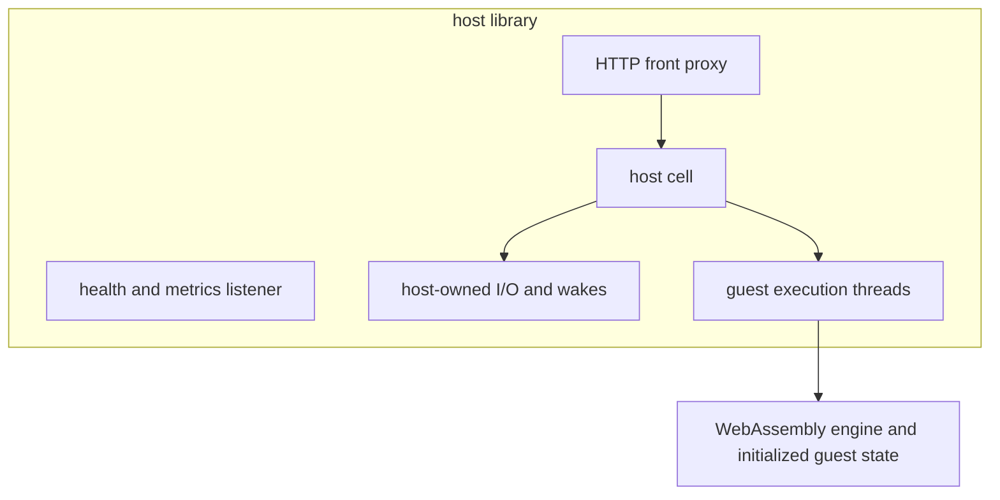

# Runtime architecture

The host library separates HTTP routing, execution cells and the WebAssembly
engine. A cell uses host threads; the WebAssembly sandbox is the guest
isolation boundary. The `wispd` command inspects local configuration and precompiles modules; it does not start the HTTP listeners.



## Listener configuration

| Configured default address | Protocol | Library endpoint |
|---|---|---|
| `127.0.0.1:8787` | HTTP/1.1 | Application requests |
| `127.0.0.1:8788` | HTTP/1.1 | `/healthz` and Prometheus `/metrics` |

The node configuration records these in `proxy.listen` and `admin.listen`.
Inspecting the configuration does not bind either address.

## The front proxy

The proxy routes ordinary HTTP requests and bounds admission with
`max_in_flight` and `max_queued`. It can refuse requests with HTTP503 when
capacity is exhausted. Response headers `x-wisp-version` and `x-wisp-tier`
identify the selected application version and compilation tier.

## The host cell

Host reactors own I/O and deliver wakes to instances through the future
table. Execution threads invoke the guest synchronously. A guest invocation
returns before it can park; the worker retains its host stack and host-owned
resources can remain live. See [Handler lifecycle](../explanation/lifecycle.md).

## The engine

The engine owns compiled modules, initialized guest state, activation and
reset. It applies dispatch budgets at the execution boundary. Capturing guest
memory does not by itself serialize host-owned resources.

## Crates

Crate manifests carry the maintained package descriptions:

```sh
cargo metadata --no-deps --format-version 1 \
  | jq -r '.packages[] | "\(.name): \(.description)"'
```

The `wisp dev` command provides embedded local application serving.

See [Workload security and isolation](../explanation/workload-security.md)
for the guest boundary and host-resource limits.
